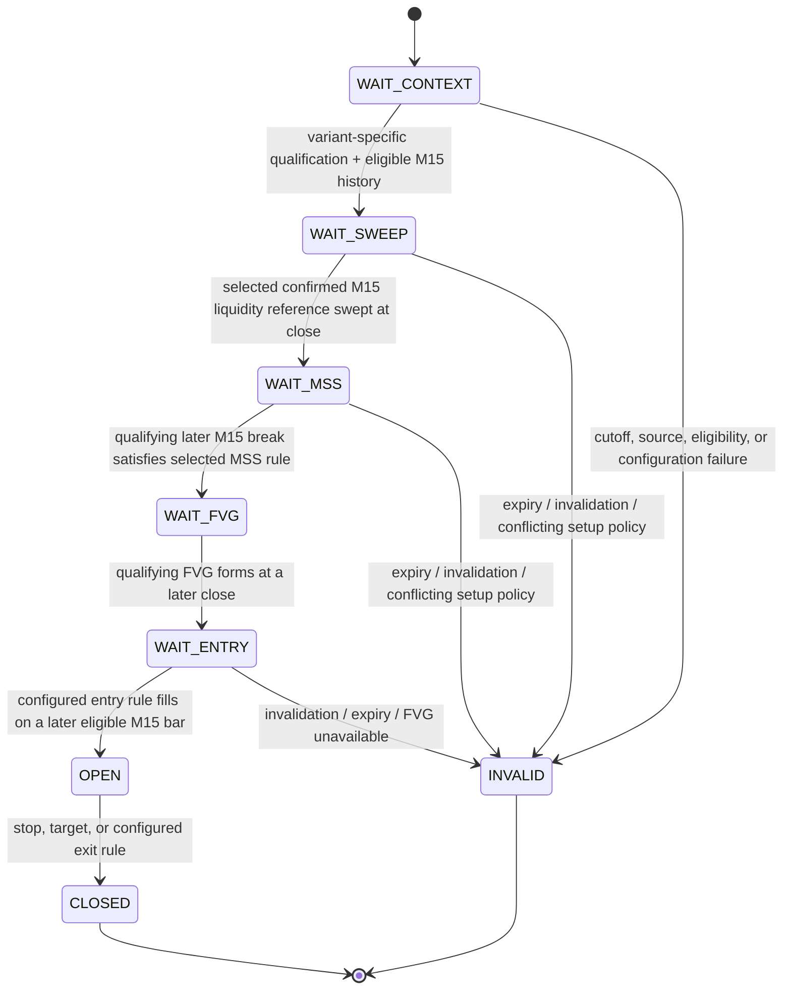

# MT5 Historical SMC Strategy — Mechanical Specification (Phase 5.1)

**Status:** The A/B/C comparison set, full-history evaluation window, H1 A2 directional-context predicate (including the owner clarification in §18.1), B2 M15 liquidity-reference/retirement policy, common zero equal-level tolerance with no equal-pool eligibility requirement, common D1 MSS convention, common M15 FVG selection/mitigation policy, common entry/fill/ambiguity policy, common stop/target policy, common pending-order invalidation/expiry/gap policy, common session/concurrency policy, and common post-entry execution/reporting/position-sizing policy are owner-approved. All 12 owner decision groups are recorded in §18. No backtest code is implemented by this document.
**Instrument/source:** Alpari MT5 Demo, `XAUUSD_i`, historical broker CFD candles.
**Permitted frames:** H1 context and M15 setup/entry evidence. Daily is excluded (`UNKNOWN_BOUNDARY`); H4 is disabled.
**Canonical clock:** UTC. Display may use `Asia/Qatar`. Source broker timestamps remain preserved under the configured fixed UTC+02:00 policy `alpari-mt5-fixed-utc-plus-2-v1`.

## 1. Objective and evidence boundary

Specify a causal, deterministic historical research setup called **SMC Liquidity Sweep + MSS + FVG**. It describes candidate entries for later backtesting; it is not a trade recommendation, live signal, executable quote, or broker instruction.

The strategy consumes only Phase 1 `ELIGIBLE_CLOSED` H1/M15 candles and Phase 2–4 observations/events whose `knowable_at` is no later than the decision instant. H1 and M15 remain separate Alpari series. SiftingIO and synthetic data never enter this strategy. No candle is fabricated, and historical CFD data is not represented as live or executable pricing.

The modules provide evidence, not this strategy’s policy. Phase 3 emits `BOS` and `CHOCH`, not an event named MSS. The owner-approved D1 convention uses the first later direction-aligned break event as strategy-level MSS while preserving its Phase 3 identity. The strategy rules recorded in §18 are owner-approved; implementation and backtesting remain outside this document’s authorization.

### 1.1 Strategy authority hierarchy

Explicit Project Owner decisions govern strategy meaning within their stated scope. Confirmed Phase 5.13 O01–O06 (§18.3) resolve the identified questions. Preserve the approved P1–P12 baseline (§18), including the A2 clarification (§18.1); incorporate C531/C551 only within their authorized corrective scope (§18.2).

This specification records those decisions. Stale passages and current code cannot override them. Tests and historical reports are evidence, not additional strategy authority. Strategy approval, implementation authorization and execution authorization remain separate. Historical implementation exists; this documentation reconciliation grants no implementation or execution permission.

Authority records: the original approvals and corrective instructions retained in the session exports, indexed by the [Phase 5.13 reconciliation](../codex-session-01a1f795-8fed-7df1-8a00-6d498e562c5e.md), and the explicit corrected owner register and latest Phase 2 plan in [Phase 2 authorization preparation](../codex-session-01a1f7b3-fb11-7d61-8c72-bc7318120b16.md). Assistant summaries do not replace owner approvals.

## 2. Time and causal rules

1. Every timestamp comparison is between aware UTC instants. Convert the preserved MT5 broker timestamp with the configured fixed UTC+02:00 offset; do not apply DST.
2. A candle decision is knowable at its nominal close (`opened_at + interval`) and only if the Phase 1 candle is `ELIGIBLE_CLOSED` at the run cutoff.
3. A swing pivot at candle *i* is usable only after the two right-hand nominal bars have closed. The existing strict unique-extremum test requires two left and two right bars; equal extrema are rejected. A five-bar swing window spanning a nominal gap is rejected.
4. A sweep is knowable only when its candle closes. Phase 3 checks previously confirmed potential levels before confirming any pivot at that same close.
5. MSS confirmation must have `knowable_at` strictly later than the sweep close. FVG formation must have `knowable_at` strictly later than the selected MSS close. The FVG’s three candles must be nominally consecutive.
6. No entry may occur on the close that first makes its conditions knowable. The earliest eligible entry bar is the next M15 candle. For A/C, H1 observations used for qualification must be closed and knowable at the M15 sweep decision instant; B has no H1 eligibility dependency.
7. On missing nominal M15 bars, never synthesize bars or count the gap as elapsed bars. The approved expiry is 16 eligible M15 candles after FVG formation. Apply H1 qualification only to A/C; B may retain H1 descriptively but H1 never affects its setup eligibility.

## 3. Existing event semantics used by the specification

### 3.1 Swings and structure breaks

`backend/app/historical_mt5/structure.py` uses strict unique extrema over 2 left + 2 right candles. Swing event `event_at` is the pivot candle close; `knowable_at` is the close of the second right candle. Labels compare with the previous confirmed same-side swing (`HH`, `LH`, `HL`, `LL`, or equal labels under configured tolerance). A tied candidate is not a pivot.

A break requires a close crossing the latest confirmed same-side level: previous close must be at or on the unbroken side and the current close strictly beyond it. A wick-only crossing is not a break. Each swing level is broken at most once. The first break seeds bias and is `BOS`; a later break in the same direction is `BOS`; a break opposite the current bias is `CHOCH`. The break event occurs at the breaking candle close and references the broken swing. These event names and semantics must not be rewritten as generic SMC definitions.

### 3.2 Liquidity and sweep

Each confirmed swing creates a potential reference (swing high = buy-side; swing low = sell-side). Equal-high/low events link matching confirmed swings using Phase 3’s configured Decimal tolerance (default in the engine is zero; no tick-size assumption). Equal matching may use an older same-side pivot, selecting nearest match and most recent on a distance tie.

`BUY_SIDE_SWEEP` requires a strict wick high above a previously confirmed buy-side level and a same-candle close strictly below it; direction is bearish. `SELL_SIDE_SWEEP` requires a strict wick low below a previously confirmed sell-side level and a same-candle close strictly above it; direction is bullish. The event is known at that candle close and retains its source-level reference. Exact touch alone does not retire a level. Strict wick penetration retires it; a penetrating wick followed by a close exactly on the level retires it without a sweep. A confirmed BOS/CHoCH explicitly referencing a swing also retires that swing. These are price-pattern references, not claims of institutional activity.

### 3.3 FVG

The engine forms a bullish FVG when the first candle’s high is strictly below the third candle’s low; bounds are `[first.high, third.low]`. A bearish FVG forms when first.low is strictly above third.high; bounds are `[third.high, first.low]`. The three candles must be nominally consecutive. Formation is known at the third candle close and starts `UNFILLED`. Later closed-candle wicks produce `PARTIALLY_MITIGATED` or `FULLY_MITIGATED` events; formation-time state never uses later candles.

## 4. Approved strategy lifecycle and current implementation mapping

The diagram is conceptual, not a claim that each node is a runtime state. Historical implementation and outstanding discrepancies are mapped in §10.



The state machine is per candidate setup. Under the approved policy, each variant keeps independent concurrency state, allows at most one pending/open setup, ignores sweeps while occupied, and applies the stable event-ID priority while flat. Scanning resumes only on subsequently eligible events after terminal exit/cancellation; ignored sweeps are never retroactively processed.

## 5. Mechanical sequence, with policy choices exposed

The following order is the specified causal sequence for the selected A/B/C comparison variants.

### Step A — establish H1 context

For Variants A and C only, evaluate the latest H1 evidence whose closed candle and event timestamps are no later than the candidate sweep close. Daily and H4 provide no evidence. Variant B bypasses every H1 qualification check; H1 information may be recorded descriptively for B but must never affect setup eligibility.

**Owner-approved A2 predicate for Variants A and C:** At the M15 sweep candle close, the two required items are (1) the Phase 4 H1 directional context label and (2) the latest confirmed H1 BOS/CHoCH direction knowable by that close. Both must be available, confirmed, non-mixed, and sufficient to establish agreement with the M15 setup direction; otherwise reject the setup. Missing descriptive Phase 4 indicator components do not independently reject a setup if both required A2 items remain valid and available. Do not add indicator unanimity requirements. Freeze this predicate at the sweep close; later H1 changes do not retroactively invalidate it. Variant B bypasses every H1 qualification check; H1 may be recorded descriptively only and must never influence eligibility.

Other context alternatives are recorded for traceability but are not active choices for the approved A2 rule:

- **A1 — Phase 4 label:** permit long setups only when H1 is exactly `BULLISH CONTEXT`; short only on `BEARISH CONTEXT`; reject `MIXED CONTEXT` and `INSUFFICIENT EVIDENCE`. This uses the current Phase 4 direction rule: available EMA 20/50/200 strict ordering, MACD line vs signal, ten-bar ROC sign, and latest BOS/CHoCH direction contribute directional components; one-sided non-neutral evidence yields a directional label, opposing components yield mixed. RSI, ATR, and premium/discount are descriptive, not direction votes.
- **A2 — structure-required:** the owner-approved predicate stated above.
- **A3 — other explicit predicate:** owner supplies required components and missing-evidence policy. No weighted score is implied.

Record the H1 evidence and source candle/event timestamps used at the sweep close. Later H1 changes do not alter this setup's qualification.

### Step B — select a previously confirmed M15 liquidity reference

At the time a sweep is observed, candidate reference must be the latest confirmed same-side M15 swing, confirmed before the sweep candle closes, and not already retired by the causal candle/event prefix. Its status is assessed using only information knowable before the current sweep close; the current setup's own sweep may consume the selected level.

**Reference variants:**

- **B1:** any still-potential Phase 3 swing reference (including an older reference retained by the engine).
- **B2 — owner-approved:** latest confirmed swing of the relevant side only, subject to the retirement policy below.
- **B3:** a confirmed equal-high/equal-low pool only, using the Phase 3 tolerance. This is not required for eligibility under the approved B2 policy.

**Owner-approved B2 retirement policy:** A swing low is permanently retired when a subsequent eligible M15 candle has a low strictly below its price; a swing high is permanently retired when a subsequent eligible M15 candle has a high strictly above its price. Exact touches do not retire a level. A confirmed BOS/CHoCH explicitly referencing that swing also permanently retires it. Never reuse a retired level. Reconstruct retirement chronologically from the causal M15 candle prefix and events knowable at the decision time; never infer retirement from future candles. The setup's own sweep may consume its selected level. Record reference event ID, original level, swing confirmation time, source row, file hash, and sweep relationship.

### Step C — observe sweep

For a long candidate, require a `SELL_SIDE_SWEEP` event at M15 close; for a short candidate, require `BUY_SIDE_SWEEP`. Its referenced level must satisfy Step B. Apply the H1 A2 qualification in Step A only for A/C; B has no H1 eligibility dependency. The sweep candle’s wick crosses the level and its close returns across it under Phase 3’s strict comparisons. No setup exists before that close.

Each variant applies its own eligibility rules while flat. If multiple setups qualify for that variant, select the lexicographically smallest stable event ID under the approved concurrency policy; while occupied, ignore new sweeps and never process them retroactively.

### Step D — confirm subsequent MSS

**O02 producer/input contract (A/B/C):** For each timeframe and candle, the Phase 3 producer supplies at most one qualifying BOS/CHoCH break. Competing same-candle break input is invalid and must be rejected. Preserve the authorized deterministic event ordering; do not select among competing MSS events or introduce an event-ID/type tie-breaker. This limits all three variants to valid producer inputs. Consumer rejection is not yet implemented (§10); preserved ordering is not an approved competition-selection rule.

MSS must be a later closed M15 structure break in the expected setup direction. The event `knowable_at` must be strictly greater than the sweep close and no later than the analysis cutoff.

**Owner-approved D1 MSS convention (A/B/C):** After a valid M15 liquidity sweep, select the first subsequent M15 `BOS` or `CHOCH` in the sweep direction. Its `knowable_at` must be strictly later than the sweep candle close. Preserve the underlying Phase 3 event type and identity; never skip the first qualifying event to select a later one. “MSS” is a strategy-level convention over the selected BOS/CHoCH event, not a dedicated Phase 3 event.

Other MSS alternatives are documented for traceability only and are not selected:

- **D1 — any directed break:** the owner-approved convention stated above. This treats event direction, not event label, as the condition.
- **D2 — CHoCH required:** require the later event type to be `CHOCH` and its direction to agree. This is stricter and may reject valid first-break cases because Phase 3 labels a neutral first break `BOS`.
- **D3 — explicit post-sweep internal level:** require close beyond a separately defined post-sweep swing/level. The current engine does not define internal/external structure or a dedicated MSS level; this needs a new strategy-level rule (and possibly additional evidence not presently emitted).

Do not relabel the event itself. Persist `mss_rule_variant = D1`, the underlying event type/ID, direction, level, knowable time, and source rows. A break known on the sweep candle cannot satisfy this step.

### Step E — require FVG after MSS

**Owner-approved FVG policy (A/B/C):** Use M15 FVGs only. Select the first direction-aligned M15 `FVG_FORMED` event with `knowable_at` strictly later than the approved MSS event. Never replace it with a later FVG. Use its midpoint as the entry reference. Keep the midpoint order active through partial and full wick mitigation. The FVG formation candle cannot trigger entry; any entry must occur on a later eligible candle. Order expiry and invalidation are governed by the separately owner-approved policy in §5H.

Require three nominally consecutive candles and retain all three source references and bounds. At formation, the FVG is `UNFILLED` by definition. An FVG formed before or on the MSS close is ineligible.

The selected FVG and midpoint reference are fixed by the approved policy above. Do not use subsequent FVGs or mitigation state to replace it. Entry activation/fill follows §6; expiry and pending-order invalidation follow approved §5H.

### Step F — enter no earlier than the next eligible M15 bar

**Owner-approved entry/fill policy (A/B/C):** Use the selected FVG midpoint as the limit price and activate at the next eligible M15 candle open. For buys, fill at observed open if `open <= limit`; otherwise fill at limit if `low <= limit`. For sells, fill at observed open if `open >= limit`; otherwise fill at limit if `high >= limit`. Cancel if the opening price is at or beyond the protective stop. The FVG formation candle cannot trigger entry. OHLC cannot reveal exact path or queue position; these are bar-model assumptions, not executable broker fills.

### Step G — initial stop, target and risk

**Owner-approved stop/target policy (A/B/C):** For a long, stop equals the originating sweep candle low; for a short, it equals that candle's high. Buffer is `Decimal("0.00")` price units. Calculate initial price risk from the actual entry fill. Reject zero, negative, or wrong-side risk. Target is fixed at `2.00R` from actual fill and initial risk; the minimum risk/reward filter is disabled. Do not move the original stop or adjust it retrospectively.

Initial price risk per abstract unit is `abs(entry_fill - original_stop)` and must be positive and on the protective side of the fill. Report price P&L and R separately; signed price P&L per abstract unit is `(exit - entry)` for long and `(entry - exit)` for short, and R is that value divided by initial price risk per unit. All results are **GROSS-ONLY**: do not estimate or deduct spread, commission, or slippage, and do not imply costs are zero or claim net profitability. Preserve imported MT5 spread for possible future research. Do not calculate monetary account P&L, equity returns, leverage, or position-sizing recommendations.

### Step H — invalidate, expire, or close

**O03 formation-close requirement (A/B/C):** When the selected FVG creates a pending order, evaluate both cancellation conditions at that formation close: the approved later opposite-direction BOS/CHoCH condition, and a close through the original sweep extreme against the setup (long: close below sweep low; short: close above sweep high). Either condition cancels the new order at that close before activation. The formation candle cannot fill it. All other pending-order rules remain unchanged. Current code checks only the opposite break at this creation close; the sweep-extreme check remains an implementation gap (§10).

**Owner-approved common pending-order policy (A/B/C):** While an order remains untouched and pending, cancel it when an eligible M15 candle closes through the originating sweep extreme against the setup, or when a later confirmed opposite-direction BOS/CHoCH becomes knowable. Do not cancel solely because the selected FVG is partially or fully wick-mitigated. Expire at the close of the 16th eligible M15 candle after FVG formation; missing bars do not count. Reject sweep events with `gap_context=true`; preserve and flag other gaps, and never synthesize missing candles. Evaluate evidence causally at candle close. If entry and invalidation could both occur in one candle, record `AMBIGUOUS_ENTRY_INVALIDATION` without inferring event order.

At analysis cutoff, preserve pending orders and open positions without fabricated fills, exits, or forced liquidation. After entry, the approved stop/target policy and execution ambiguity rules apply; no additional time/structure exit is implied.

## 6. Owner-approved common entry/fill and ambiguity policy (A/B/C)

Historical OHLC observations are not executable broker quotes. These rules define a deterministic bar model and do not claim actual broker execution.

- **Entry:** use the selected M15 FVG midpoint as the limit price. Activate the order at the next eligible M15 candle open; the FVG formation candle cannot trigger entry. For a buy, if open `<= limit`, fill at observed open; otherwise fill at limit if low `<= limit`. For a sell, if open `>= limit`, fill at observed open; otherwise fill at limit if high `>= limit`.
- **Stop-through opening:** cancel if the opening price is at or beyond the protective stop (buy: open `<= stop`; sell: open `>= stop`).
- **Entry/invalidation ambiguity:** if one candle can satisfy the entry condition and also closes through an invalidation level or confirms an invalidating opposite break, label `AMBIGUOUS_ENTRY_INVALIDATION`.
- **Entry-bar exit ambiguity:** if the entry candle also touches stop and/or target such that OHLC cannot establish event order, label `AMBIGUOUS_ENTRY_BAR`.
- **Ambiguous outcomes:** exclude both ambiguity classes from primary win/loss and expectancy calculations. Report counts and possible outcomes separately for each ambiguity class.
- **Later-candle exits:** use inclusive OHLC touch tests (long stop `low <= stop`, target `high >= target`; short stop `high >= stop`, target `low <= target`). If both stop and target are touched, stop wins; if only stop is touched, exit at stop; if only target is touched, exit at target. On an adverse gap through the stop (long open `< stop`, short open `> stop`), exit at the next observed open when it is worse than the stop. On a favorable gap through the target (long open `> target`, short open `< target`), exit at the target, not the better opening price.
- **Cutoff:** preserve pending orders and open positions without fabricated fills, exits, or forced liquidation.
- Never invent intrabar price paths or claim actual broker execution. Flag ambiguity where OHLC cannot show event ordering.

**Owner-approved reporting and sizing (A/B/C):** label every result `GROSS-ONLY`; do not estimate or deduct spread, commission, or slippage, and do not imply transaction costs are zero or claim net profitability. Preserve imported MT5 `SPREAD` data for future research. Use one abstract unit; report price P&L and R separately. Do not calculate monetary account P&L, equity returns, leverage, or position-sizing recommendations. No automatic trading, order submission, broker connection, or claim of executable pricing is permitted.

## 7. Synthetic illustrations (not market data)

Illustrations demonstrate event ordering only. Each listed OHLC is a synthetic closed M15 candle. Assume the prior swing was already confirmed before the sweep, tolerance and buffer are configured, and a long-side H1 predicate is satisfied. Values do not choose strategy parameters.

### Long candidate

| UTC close | Synthetic OHLC | Evidence/state |
|---|---|---|
| 10:00 | O 100.4, H 101.0, L 100.0, C 100.5 | Previously confirmed M15 swing low reference is 100.0 (known before this sequence). |
| 10:15 | O 100.4, H 100.7, L 99.7, C 100.2 | Low crosses below 100.0 and close returns above: `SELL_SIDE_SWEEP`, known at 10:15. |
| 10:30 | O 100.2, H 100.8, L 100.1, C 100.6 | If this close strictly crosses the latest confirmed M15 swing high and meets selected MSS variant, confirm bullish MSS at 10:30. |
| 10:45 | O 100.6, H 101.1, L 100.5, C 101.0 | First candle of candidate FVG pattern. |
| 11:00 | O 101.0, H 101.4, L 100.9, C 101.3 | Second candle. |
| 11:15 | O 101.3, H 101.8, L 101.2, C 101.7 | Third candle; if `first.high < third.low`, bullish FVG `[101.1, 101.2]` is known at 11:15. |
| 11:30 | candle 11:15–11:30 | Earliest eligible entry bar begins at 11:15; actual fill depends on selected entry variant. |

The row labeled 10:30 is qualifying only if the Phase 3 break condition is actually met from an already confirmed reference; the table does not manufacture a BOS/CHoCH. If no qualifying reference exists, no MSS occurs. The FVG boundaries in this example follow the synthetic first high and third low.

### Short candidate

| UTC close | Synthetic OHLC | Evidence/state |
|---|---|---|
| 14:00 | O 200.0, H 201.0, L 199.7, C 200.3 | Previously confirmed M15 swing high reference is 201.0. |
| 14:15 | O 200.4, H 201.4, L 200.1, C 200.7 | High crosses above 201.0 and close returns below: `BUY_SIDE_SWEEP`, known at 14:15. |
| 14:30 | O 200.7, H 200.9, L 199.9, C 200.0 | If close strictly crosses a previously confirmed swing low and meets selected MSS variant, confirm bearish MSS. |
| 14:45 | O 200.0, H 200.2, L 199.5, C 199.7 | First candle of candidate bearish FVG pattern. |
| 15:00 | O 199.7, H 199.8, L 199.2, C 199.4 | Second candle. |
| 15:15 | O 199.3, H 199.4, L 199.0, C 199.2 | Third candle; `first.low > third.high`, so bearish FVG `[199.4, 199.5]` is known at 15:15. |
| 15:30 | candle 15:15–15:30 | Earliest eligible entry bar begins at 15:15; actual fill depends on selected entry variant. |

As with the long illustration, the break must be proven from the actual prior confirmed swing history. The example’s bearish FVG boundary is the third high through the first low; the row values are illustrative and not a validated price sequence or recommendation.

## 8. Required setup/trade record and current reporting coverage

Historical setup/trade reporting exists in `backtest.py`; this section specifies required coverage, not a claim of complete implementation. **O04:** `entry_at` identifies the containing M15 candle by its opening timestamp. Opening fills at the observed open and intrabar limit-touch fills must be distinguishable. For a touch fill, OHLC does not establish the exact intrabar fill instant; `entry_at` must not be presented as that instant. The current record/serializer lacks a fill-type discriminator (§10); its field name and compatibility/version treatment require later implementation design.

At minimum, the strategy record must retain: provider/broker/symbol/source classification; timeframe role; series ID; Daily/H4 exclusion statuses; source file hash and timezone policy; setup ID; selected parameter/config version; H1 context components and their timestamps; liquidity reference event ID, side, level, confirmation time and source rows; sweep event ID/time/price; MSS variant and underlying BOS/CHoCH event ID/time/level; FVG event ID/time/bounds/state and three source rows; entry rule/decision time/bar/fill price and opening-versus-touch fill distinction; stop/target rule and prices; initial price risk; expiry/invalidation reason; exit event/time/price; `GROSS-ONLY` label; preserved raw spread metadata (not used as a cost); abstract-unit price P&L and R; and any ambiguity/gap flags.

All input provenance must continue to identify Alpari MT5 historical CFD data. The original broker timestamp and normalized UTC timestamp must remain recoverable from source row references and source hash.

## 9. Configuration parameters requiring explicit values

A reproducible run must serialize every selected value and variant. All 12 owner decision groups are listed in §18; their approval does not authorize implementation or a backtest.

| Parameter | Choices/meaning requiring configuration |
|---|---|
| H1 context predicate | **Resolved:** owner-approved A2 in §5; A/C predicate is frozen at sweep close, and B has no H1 gate. |
| Liquidity reference | **Resolved:** owner-approved B2 and retirement policy in §5B; multiple qualifying setups while flat follow the owner-approved stable event-ID priority in §14. |
| Equal-level tolerance | **Resolved:** `Decimal("0")` price units, common to A/B/C; equal pools are not mandatory, unequal prices are not equal pools, and no tick-size tolerance is used. |
| MSS predicate | **Resolved:** owner-approved D1 in §5D, common to A/B/C, subject to O02 cardinality and invalid-input rejection; no new tie-breaker. |
| FVG selection | **Resolved:** common approved M15-only first aligned FVG strictly after D1 MSS; midpoint reference; keep active through partial/full wick mitigation; formation candle cannot trigger entry. |
| Entry method | **Resolved:** approved M15 FVG midpoint limit, activation at next eligible candle open, side-specific open/touch fill rules, and stop-through opening cancellation in §6. |
| Stop | **Resolved:** originating sweep candle low for long/high for short; buffer `Decimal("0.00")`; risk from actual fill; reject nonpositive/wrong-side risk; never move/revise original stop. |
| Target | **Resolved:** fixed `2.00R` from actual fill and initial risk. |
| Minimum reward/risk | **Resolved:** disabled. |
| Invalidation | **Resolved:** common pending-order invalidation policy in §5H, including both O03 formation-close cancellation conditions before activation; applies only while untouched and pending. |
| Setup expiry | **Resolved:** close of the 16th eligible M15 candle after FVG formation; missing bars do not count; cutoff preserves pending/open state without fabricated exit. |
| Session filter | **Resolved:** A/B disabled; C uses the approved configured IANA windows at sweep close, start inclusive/end exclusive; see §14. |
| Concurrent setups | **Resolved:** maximum one pending/open setup per variant; ignore sweeps while occupied; stable-ID priority while flat; independent A/B/C state; see §14. |
| Gap policy | **Resolved:** reject `gap_context=true` sweeps; preserve/flag other gaps; no synthetic candles; see §5H. |
| Fill and exit model | **Resolved:** owner-approved entry/fill/ambiguity and post-entry exit policy in §6. |
| Costs/reporting | **Resolved:** all results gross-only; no cost estimates or deductions; do not imply zero costs or net profitability; preserve source spread. |
| Position sizing | **Resolved:** one abstract unit for price P&L and R only; no monetary, equity, leverage, or sizing recommendations. |

Do not optimize these parameters against the same history used to claim performance. A later research protocol should separate specification, calibration and out-of-sample evaluation.

## 10. Rule-to-implementation traceability

This mapping distinguishes approved rules, inspected implementation, known discrepancies and evidence limitations. Source inspection does not establish runtime correctness or historical execution provenance. Paths below are relative to `backend/app/`; line anchors identify the executable source inspected for the reviewed plan, before this documentation-only docstring edit. P1–P12 correspond to the twelve checklist groups in §18, in order.

| Rule / owner authority | Specification | Implementation anchors | Current status / evidence limitation |
|---|---|---|---|
| P1 — independent A/B/C | §§15–16, 18 | `historical_mt5/backtest.py:33,425–439,712–716` | Independent variant implementation exists; not executed here. |
| P2 — common inputs/window | §15.1 | `backtest.py:42–52,349–379`; `historical_mt5/engine.py` eligibility; `data/mt5_import.py`, `historical_mt5/models.py` provenance | Approved-scope validation exists; no CSV parsing or boundary recalculation here. |
| P3 — A2 A/C only, B bypass | §§5A, 18.1 | `backtest.py:_H1AsOf:253–277,_eligible_sweep:462–474`; `historical_mt5/confluence.py:_direction:258–289` | Predicate implementation exists; indicators are descriptive except as used by the approved Phase 4 label. No new unanimity gate. |
| P4 — B2 reference/retirement | §§3.2, 5B | `backtest.py:454–461,620–637`; `historical_mt5/structure.py:330–344` | Strict retirement exists; pure exact touches remain eligible. No older-level substitution. |
| P5 — zero tolerance, optional pools | §§9, 14, 18 | `backtest.py:287–288`; `structure.py:282–288,430–471` | Existing Decimal-zero policy; no tick-size assumption. |
| P6 — D1 MSS; O02 | §5D | `structure.py:346–366`; `backtest.py:280–346,590–595,640–646,740` | Producer cardinality exists. **O02 gap:** consumer lacks explicit competing-input rejection, selects first aligned input, and generated configuration still says competition is unresolved. That behavior cannot override O02. |
| P7 — first later aligned FVG; C551 | §5E | `structure.py:390–414`; `backtest.py:648–650` | Uppercase producer direction is recognized; no replacement rule added. |
| P8 — entry/fill/ambiguity; O04 | §§5F, 6, 8 | `backtest.py:492–548,55–82,179–193` | Fill logic and candle-open `entry_at` exist. **O04 gap:** record/serializer lacks opening-versus-touch discriminator; field/schema compatibility design remains deferred. |
| P9 — stop/risk/2R | §5G | `backtest.py:521–531,651–654` | Implementation exists; not executed here. |
| P10 — cancellation/expiry/gaps; O03 | §5H | `backtest.py:476–483,498–555,600–605,651–665,682–689` | Later pending bars evaluate both conditions. **O03 gap:** creation close checks only opposite break, not close through sweep extreme. Historical occurrence and metric effect are unknown. |
| P11 — sessions/concurrency | §§14, 18 | `backtest.py:472–473,599–610,669–680`; `analysis/sessions.py:13–31` | Implemented research windows and independent occupancy; no broker-session verification. |
| P12 — exits/accounting/sizing | §§6, 18 | `backtest.py:382–407,557–587,758–763` | Gross-only abstract-unit ledger/statistics exist; no net-profitability or runtime claim. |
| C531 — scoped corrections | §18.2 | `backtest.py:349–379,535–548,590–595,621–635,656–665` | Input/window enforcement, touched-only ambiguity outcomes, ordering, low-swing retirement and formation-close opposite-break correction; not authority for a new MSS tie-breaker. |
| C551 — P7 recognition correction | §§5E, 18.2 | `backtest.py:648–650`; `structure.py:396–408` | Restores aligned FVG recognition; does not establish complete historical generating source. |

Supporting evidence plumbing remains in `historical_mt5/indicators.py`, `confluence.py` and `sequential.py`; sequential snapshots are not the strategy state machine. The existing synthetic competing-MSS acceptance test (`backend/tests/test_historical_mt5_backtest.py:385–399`) conflicts with O02 and remains untouched. Test definitions and retained historical outcomes are not current execution evidence. O02–O04 require separate implementation/test authorization; no executable changes are part of this reconciliation.

## 11. Test cases required before a backtest can be trusted

Tests should use small independent synthetic fixtures and assert timestamps, event IDs/references, values, and state transitions. They must cover at least:

1. Reject a candle not `ELIGIBLE_CLOSED`; enforce analysis cutoff and UTC-aware instants.
2. Preserve fixed UTC+02:00 conversion, original broker timestamp, source hash, source row, provider and independent H1/M15 series.
3. Exclude Daily (`UNKNOWN_BOUNDARY`) and reject H4; never combine SiftingIO or synthetic series.
4. Swing is unavailable until two right bars close; tied high/low is not a swing; swing window across a nominal gap is rejected.
5. A wick-only level cross does not emit BOS/CHoCH; strict close cross does; first break is BOS; same-direction break is BOS; opposite direction is CHOCH; same swing level does not duplicate.
6. Sweep of previously confirmed buy-side/sell-side level requires strict wick-through and same-candle strict close-back; event is unavailable before close; level reference and source rows are retained; close-through alone is not a sweep.
7. Apply B1/B2/B3 reference selection and configured equal-level tolerance; tie/nearest match and multiple same-close sweep policy are deterministic.
8. Approved D1 selects the first aligned `BOS` or `CHOCH` strictly after sweep close, including a neutral first-break `BOS`; preserve its event type, do not skip it, and reject wrong-direction or same-close events. D2/D3 are not selected.
9. Approved FVG policy uses M15 only, first direction-aligned formation strictly after D1 MSS, preserves three consecutive source candles and exact boundaries, and begins unfilled; reject gap-spanning patterns and formation at/before MSS.
10. Never replace the selected FVG with a later one; keep its midpoint order active through partial/full wick mitigation; never let the formation candle trigger entry. Expiry/invalidation follow their separately selected rules.
11. Earliest entry is next eligible bar; test next-open, limit, touch, opening gap-through and missing-bar behavior independently; no fills inferred before the decision close.
12. Stop anchor/buffer gives correct side and positive risk; fixed target is `2.00R`; minimum R:R filter is disabled.
13. Approved pending-order invalidation/expiry/gap rules are causal, apply only while untouched and pending, and are tested at candle close; gaps do not count toward the 16 eligible-candle expiry; cutoff preserves pending/open state without fabricated exit.
14. Entry-bar stop/target contact is labeled `AMBIGUOUS_ENTRY_BAR`; on later bars both touched means stop first, stop-only exits at stop, and target-only exits at target. Test adverse stop gaps at worse next open and favorable target gaps at target.
15. Signed price P&L and R use one abstract unit and initial price risk; all results are gross-only, no costs are estimated/deducted, and imported spread is retained without implying zero costs.
16. Same data/config produces identical ordered setup/trade records and fingerprints; prefix invariance holds; later candles cannot change an earlier setup decision.
17. Concurrent setup policy, multiple FVGs, repeated sweeps and overlapping setups follow configured deterministic ordering.
18. Result records contain provider/source identity, hashes, original timestamp, UTC time, timezone policy, source row references, selected algorithm versions, config and uncertainty flags.

## 12. Known limitations

- Phase 3 does not emit an MSS concept, distinguish internal from external structure, or define a post-sweep MSS level. Any such meaning must be selected as an explicit variant or implemented as a strategy-specific rule later.
- Phase 4’s directional context is a lightweight evidence label. It is not a validated trend filter and may become directional from one available directional component; missing indicators are reported.
- MT5 OHLC candles do not reveal intrabar path, executable bid/ask, queue position, or exact fill. M15 cannot resolve same-bar stop/target order.
- The existing spread field is retained source metadata for future research, not a transaction-cost input in this comparison. Commission and slippage are not modeled; all results are gross-only.
- Daily boundary is unknown and Daily is unavailable for strategy context. H4 remains disabled.
- Session windows are configured research windows, not verified Alpari session boundaries. The owner-approved C filter is defined in §14; A/B filters are disabled.
- Historical gaps may reflect sessions/weekends or coverage differences. They are advisory; no gaps are filled, and the strategy must state its expiry/gap policy.
- The data is historical broker CFD research data, not live market data or guaranteed executable broker pricing. No claim of profitability or universal provider correctness is made.

**HISTORICAL SOURCE STATE NOT VERIFIED.** The complete executable source state that generated Phase 5.6 has not been independently verified. Version labels, current source hashes and retained corrective patches do not establish that complete generating state. This limitation alone does not invalidate the reported historical metrics. No retroactive provenance is asserted. See §15.2.

## 13. Owner decision status

All 12 owner decision groups for this strategy comparison are approved and listed in §18. The owner clarification in §18.1 refines the existing H1 A2 group without adding a decision group or changing other strategy rules. O01–O06 are confirmed Project Owner decisions (§18.3); the identified owner questions are resolved. Implementation discrepancies, technical design details and evidence limitations remain separately tracked (§10). This reconciliation grants no new implementation, testing or historical execution permission. Implementation must follow these rules without adding cost assumptions, monetary sizing, or other behavior not specified here. OHLC cannot establish intrabar ordering on the entry candle; preserve the approved ambiguity label and separate possible outcomes. On later bars, the approved stop-first rule resolves a double touch mechanically. Preserve pending/open states at cutoff without inventing a terminal price.

## 14. Phase 5.2 decision matrix

The support column describes Phase 1–4 capability at the original decision stage, not a current implementation inventory; see §10. The approved O02, O03 and O04 clarifications in §§5D, 5H and 8 apply to the corresponding MSS, invalidation and entry rows below without changing the original alternatives or other approved rules.

The matrix records alternatives and existing Phase 1–4 support. Values marked owner-approved are approved; no recommendations are fitted or optimized against historical results. “Missing” describes strategy/backtest policy not present in Phase 1–4.

| Decision | Mechanical alternatives and setup-selection effect | Existing support / missing functionality | Proposed initial research configuration and limitation |
|---|---|---|---|
| 1. H1 directional context | Require Phase 4 directional label only; additionally require latest H1 break direction agree; require unanimous indicator alignment; omit H1. Filters reduce trades and can reject countertrend M15 setups. | Phase 4 builds an as-of H1 context from EMA alignment, MACD, momentum and latest BOS/CHoCH; opposing directional components produce mixed. It is not a strategy filter. | **OWNER-APPROVED A2:** A/C require exactly two H1 qualification items at sweep close: the Phase 4 directional context label and latest confirmed H1 BOS/CHoCH direction. Each must be available/confirmed and both must establish agreement with setup direction; missing, unconfirmed, mixed, or insufficient evidence rejects. Missing descriptive Phase 4 indicator components alone do not reject when both required items remain valid; no indicator unanimity is added. Freeze then; later H1 changes do not invalidate. **B:** bypasses every H1 qualification check; H1 is descriptive only and never affects eligibility. Limitation: A2 does not require indicator unanimity. |
| 2. M15 liquidity reference | Any still-potential swing; latest confirmed swing of relevant side; equal-high/low pool only; a cluster of multiple references. Wider pools can increase sweeps; latest-only limits older-level setups. | Phase 3 emits confirmed swing levels, equal-level events and sweep reference IDs. It does not emit a complete liquidity retirement history for every wick interaction. | **OWNER-APPROVED B2:** select the latest confirmed same-side swing confirmed before sweep close, if not previously retired. A subsequent eligible candle's low strictly below a swing low or high strictly above a swing high permanently retires it; exact touch does not. A confirmed BOS/CHoCH explicitly referencing it also retires it. The setup's own sweep may consume its level. Reconstruct status only from the causal candle/event prefix; never reuse retired levels or infer retirement from future candles. Limitation: retirement must be derived from chronological evidence because Phase 3 has no generic retirement event. |
| 3. Equal-high/low tolerance | Exact equality (0); positive Decimal price tolerance; tick-multiple tolerance with explicit tick size. Larger tolerance creates more equal pools and may link more swing pairs. | Phase 3 accepts nonnegative Decimal price tolerance; default is `Decimal("0")`; no tick size is defined. | **OWNER-APPROVED COMMON RULE (A/B/C):** `Decimal("0")` price units. Equal-high/low pools are not required; individual confirmed M15 swings remain eligible under B2. Unequal prices are not equal pools. No tick-size tolerance is introduced because no tick size is established. |
| 4. MSS definition | Any later aligned BOS/CHoCH; CHoCH only; break of a separately defined post-sweep internal pivot; custom close rule. CHoCH-only suppresses neutral first-break cases (Phase 3 calls first break BOS); custom level changes event selection. | Phase 3 close-cross logic emits BOS/CHoCH, seeded by first break; there is no dedicated MSS event, internal/external classification, or post-sweep MSS level. | **OWNER-APPROVED D1 (A/B/C):** after a valid M15 sweep, select the first subsequent M15 BOS or CHoCH in sweep direction with `knowable_at` strictly later than the sweep candle close. Preserve the original event type; never skip that first qualifying event. Limitation: this is a strategy convention and does not add a Phase 3 MSS event or internal/external structure semantics. |
| 5. FVG selection | First qualifying FVG after MSS; latest; nearest to price; all; require initially unfilled, or allow partial mitigation. These choices change number and timing of pending entries. | Phase 3 emits causal FVG formation and later partial/full mitigation events, with exact three-candle references. | **OWNER-APPROVED COMMON POLICY (A/B/C):** M15 only; first direction-aligned FVG strictly after D1 MSS; never replace it; midpoint is entry reference; keep order active through partial/full wick mitigation; formation candle cannot trigger entry. Expiry and invalidation remain separate. |
| 6. Entry and fill model | Next-bar open; FVG boundary/midpoint limit; first zone touch; market after confirmation. Limits require OHLC fill assumptions and are sensitive to gap/open treatment. | Phase 1–4 provide candles/events only. No orders, fills, queue model or strategy entry timing exist. | **OWNER-APPROVED COMMON POLICY (A/B/C):** use the selected M15 FVG midpoint as limit; activate at the next eligible M15 candle open. Buy: if open `<= limit`, fill at observed open; else fill at limit if low `<= limit`. Sell: if open `>= limit`, fill at observed open; else fill at limit if high `>= limit`. Cancel if opening price is at or beyond the protective stop. Formation candle cannot trigger entry. Entry/invalidation and entry-bar exit ambiguities get the specified labels and are excluded from primary win/loss and expectancy; later-candle stop/target conflict is stop-first; adverse gap-through-stop exits at next open. Limitation: this is a bar model, not actual broker execution. |
| 7. Stop-loss and buffer | Sweep extreme; MSS reference extreme; far FVG edge; fixed-price/ATR/tick buffer. Wider stops reduce false exits but increase price risk and may eliminate RR-qualified setups. | Candles and swing/FVG levels exist; no stop, buffer, tick-size or stop-distance rules exist. ATR is available but no stop formula uses it. | **OWNER-APPROVED COMMON POLICY (A/B/C):** long stop equals originating sweep candle low; short stop equals its high; buffer `Decimal("0.00")`; initial risk from actual fill; reject zero/negative/wrong-side risk; never move or retrospectively adjust original stop. |
| 8. Take-profit | Fixed R multiple; nearest previously confirmed opposing swing/liquidity; fixed price distance; time/structure exit. Different targets change holding time and win/loss distribution. | Phase 3 has confirmed swing levels; there is no TP selection or order management. | **OWNER-APPROVED COMMON POLICY (A/B/C):** fixed `2.00R` target from actual fill and initial risk. |
| 9. Minimum risk/reward | No filter; minimum threshold; threshold based on liquidity target distance. A threshold removes entries with insufficient planned reward. | No strategy RR filter exists; prices and Decimal arithmetic are available. | **OWNER-APPROVED:** minimum risk/reward filter disabled for A/B/C. |
| 10. Setup invalidation | Before fill: sweep extreme close invalidation; opposite BOS/CHoCH; H1 context change; expiry; combinations. More conditions cancel more pending setups. | Phase 3 supplies close-known breaks and FVG transitions; Phase 4 supplies as-of H1 context. No setup lifecycle exists. | **OWNER-APPROVED COMMON POLICY (A/B/C):** while untouched and pending, cancel when an eligible M15 candle closes through originating sweep extreme against setup, or on a later confirmed opposite-direction BOS/CHoCH. Apply evidence causally at candle close. FVG mitigation alone never cancels. If entry and invalidation could both occur in one candle, label `AMBIGUOUS_ENTRY_INVALIDATION`; do not infer event order. |
| 11. Setup expiry | N eligible M15 bars from sweep, MSS or FVG; elapsed UTC duration; end of session/day; cutoff. Longer expiry allows more retests but retains stale setups. | Phase 1 cutoff and ordered eligible bars exist; no strategy expiry exists. | **OWNER-APPROVED COMMON POLICY (A/B/C):** expire at the close of the 16th eligible M15 candle after FVG formation; missing bars do not count. At analysis cutoff preserve pending/open states without fabricated exits. |
| 12. Session filter | Off; session at sweep close; session at FVG formation; session at entry; one or more named windows. Filter point changes qualified events. | `analysis/sessions.py` has IANA-timezone labels and Phase 4 can report them. These are configured windows, not verified Alpari session boundaries. | **OWNER-APPROVED COMMON POLICY (A/B/C):** A/B session filters disabled. For C, require the sweep candle close to fall inside at least one configured window: Asia/`Asia/Qatar` 08:00–15:00, London/`Europe/London` 08:00–17:00, or New York/`America/New_York` 08:00–17:00. Use IANA timezones and their DST rules; start is inclusive and end exclusive. This classifies sweep close only and does not claim broker-session validation. |
| 13. Gap handling | Reject only structural patterns spanning a gap; reject setups touching gaps; pause or count gaps for expiry; no synthetic fill. | Phase 3 rejects swing windows and FVG patterns spanning nominal gaps and marks gap context; Phase 1 gap candidates are advisory. No bars are fabricated. | **OWNER-APPROVED COMMON POLICY (A/B/C):** reject sweeps with `gap_context=true`; preserve and flag other gaps; missing bars do not count toward expiry; never synthesize candles. Limitation: `gap_context` identifies a nonconsecutive prior interval, not whether it was a normal weekend/session closure. |
| 14. Concurrent setups | Allow all; one per liquidity reference; one per direction; one open/pending setup total; deterministic priority. More concurrency can produce overlapping trades and duplicate exposure. | Existing event IDs/order are deterministic; no setup grouping or concurrency control exists. | **OWNER-APPROVED COMMON POLICY (A/B/C):** maximum one pending/open setup per variant, with independent state for A, B and C. Ignore new sweeps while that variant is occupied. While flat, if multiple setups qualify, select the lexicographically smallest stable `event_id`. After terminal exit/cancellation, resume from subsequently eligible events only; never retroactively process sweeps ignored while occupied. Limitation: stable priority discards overlapping evidence and does not imply better setup quality. |
| 15. Transaction costs/reporting | Apply configured spread/commission/slippage; estimate from MT5 spread field; omit costs. Cost assumptions can materially alter results. | Importer preserves integer `spread`; no documented unit-to-price conversion, commission, slippage, or fill-side model is supplied. | **OWNER-APPROVED:** label all results `GROSS-ONLY`; do not estimate/deduct spread, commission, or slippage; do not imply costs are zero or claim net profitability; retain imported spread for future research. Limitation: gross results cannot establish net profitability. |
| 16. Monetary position sizing | Fixed quantity; fixed monetary risk; percentage equity risk; per-unit R only. Monetary sizing needs account, contract and conversion assumptions. | Candle price risk and R can be computed later; no account equity, contract size, leverage, currency conversion or sizing model exists. | **OWNER-APPROVED:** use one abstract unit and report price P&L and R separately; no monetary account P&L, equity return, leverage, or position-sizing recommendation. Limitation: per-unit R is not account return or position guidance. |

## 15. Owner-approved comparison scope

The owner selected **all three variants—A, B, and C—as the side-by-side comparison set**. The common H1, liquidity, tolerance, MSS, FVG, entry/fill/ambiguity, stop/target, invalidation/expiry/gap, session/concurrency, and post-entry execution/reporting/position-sizing rules explicitly checked in §18 are approved.

Run each variant independently. Do not share setup state, position state, or signals between variants. For a fair comparison, use the exact same validated Alpari MT5 source files and SHA-256 hashes, imported H1 and M15 candles, analysis cutoff/evaluation window, importer and analysis algorithm versions, and the common owner-approved rules. Variant-specific differences are limited to their defining H1/session qualification rules. Do not merge H1 and M15 candles into one series. Keep source timezone policy fixed at UTC+02:00 with no DST adjustment. Exclude Daily (`UNKNOWN_BOUNDARY`) and keep H4 disabled. Keep SiftingIO, synthetic inputs, and live analysis outside all three runs.

The full-history window and data-derived cutoff are recorded in §15.1. Approval of the comparison scope and all 12 decision groups does not itself authorize implementation or execution of a backtest.

### 15.1 Owner-approved historical window and source provenance

The owner approved the full available Alpari MT5 XAUUSD_i history, beginning with the first imported H1/M15 source observation dated 2021-01-04 in broker time and ending at the latest fully closed common H1/M15 observation. This approves the window and common cutoff only; it does not approve any strategy parameter.

Paths below are project-relative. SHA-256 values were computed/reported by running the existing offline importer on the actual files. H1 and M15 hashes are fixed comparison inputs. The Daily hash is recorded only for provenance; every Daily candle remains `UNKNOWN_BOUNDARY` and excluded from analysis.

| Timeframe | Exact source file path | SHA-256 | Use |
|---|---|---|---|
| H1 | `data/raw/mt5/alpari_xauusd_i/2026-11-19/XAUUSD_i_H1_202101040100_202611191300.csv` | `e1465d2ef9cbb089647933b6abee9ca68adc35d9be31f5d57c0cd4eff9500e64` | Comparison input |
| M15 | `data/raw/mt5/alpari_xauusd_i/2026-11-19/XAUUSD_i_M15_202101040100_202611191345.csv` | `a9e177af909a6373db778c3e6f4c42a1353c3e5359b8ef49ac3fd152f0969efa` | Comparison input |
| Daily | `data/raw/mt5/alpari_xauusd_i/2026-11-19/XAUUSD_i_Daily_202101040000_202611190000.csv` | `4b2b796f61e76f607dfedf6a150ec6884f62081a107b17afcdc06b5a8f4812a5` | Provenance only; excluded (`UNKNOWN_BOUNDARY`) |

**Evaluation window and exact timestamps:**

- First H1 and M15 candles have broker timestamp `2021.01.04 01:00:00` under fixed UTC+02:00, which normalizes to UTC open `2021-01-03T23:00:00Z`. The first common H1/M15 closed-observation instant is `2021-01-04T00:00:00Z`. Thus “beginning 2021-01-04” describes the broker/source date; the actual UTC candle-open boundary is on 2021-01-03.
- The common analysis cutoff is **`2026-11-19T12:00:00Z` (UTC)**, inclusive of candles whose nominal close equals that instant. The latest H1 source candle is broker timestamp `2026.11.19 13:00:00`, UTC open `2026-11-19T11:00:00Z`, nominal close `2026-11-19T12:00:00Z`. The latest M15 source candle is broker timestamp `2026.11.19 13:45:00`, UTC open `2026-11-19T11:45:00Z`, nominal close `2026-11-19T12:00:00Z`.
- The first and last shared nominal close instants computed from the imported H1/M15 observations are `2021-01-04T00:00:00Z` and `2026-11-19T12:00:00Z`, respectively; there are 33,867 common close instants.

**Cutoff derivation:** the existing importer parsed the supplied files, applied its fixed UTC+02:00 conversion, and returned validated candle objects with original broker timestamps and file hashes. It saw and accepted 170,951 rows across Daily/H1/M15 and reported zero issues. For H1 and M15 separately, derive each candle's nominal close from its imported UTC open plus its configured timeframe interval. Intersect the resulting H1 and M15 close instants and select the latest instant; that maximum is `2026-11-19T12:00:00Z`. This is based on accepted imported candles and interval rules, not filename ranges or export timestamps. At this cutoff, both latest candles are fully closed and valid according to importer validation. The fixed source policy remains `alpari-mt5-fixed-utc-plus-2-v1`; no DST adjustment is applied.

Each A/B/C run must use exactly these H1/M15 files and hashes, the same inclusive UTC window (`2021-01-03T23:00:00Z` first open through `2026-11-19T12:00:00Z` cutoff), identical importer/analysis algorithm versions and common approved entry/fill rules and configured execution assumptions. Process H1 and M15 independently and align them causally at M15 decision times. Do not use Daily candles, H4, SiftingIO, synthetic series, or live data.

### 15.2 Historical generating-source limitation

**HISTORICAL SOURCE STATE NOT VERIFIED.** The complete executable source state that generated Phase 5.6 has not been independently verified. Current source hashes, strategy version labels and the retained C551 patch cannot identify that complete state. This limitation does not automatically invalidate the reported historical metrics; no retroactive provenance is asserted. Phase 5.4, 5.5 and 5.6 reports remain historical artifacts, not evidence that O02–O04 are implemented. Source-data hashes in §15.1 do not establish executable-source provenance. No importer, backtest or metric calculation was run for this reconciliation; §15.1 retains historical observations without recalculation. Phase 5.9C–5.12 source-closure, runtime/configuration, real-report adapter, independent acceptance, lifecycle and import-isolation prerequisites remain separate and unimplemented by this document.

## 16. Three selected comparison variants

All variants use Alpari MT5 historical XAUUSD_i only, eligible closed H1/M15 candles, the Phase 3 event definitions above, and no Daily/H4. The approved common rules apply to all three; differences are limited to the approved H1 and session qualification rules.

| Variant | Qualification |
|---|---|
| **A — Strict SMC** | Uses the A/C-only owner-approved A2 predicate detailed in §5 and §18.1; later H1 changes do not invalidate. Uses approved B2, D1, and common M15 FVG selection/mitigation policy. Common approved entry, risk, session, concurrency, and exit rules apply. Expected to select fewer setups than B; H1 remains contextual evidence, not a guarantee. |
| **B — M15-only SMC** | Bypasses every H1 qualification check (owner-approved); H1 may be logged descriptively only and never affects eligibility. Uses approved B2, D1, and common M15 FVG selection/mitigation policy; common approved entry, risk, concurrency, and exit rules apply. Expected to include counter-H1 and more setups; comparisons should retain the same M15 evidence and cost labeling. |
| **C — Session-filtered SMC** | Uses the A/C-only owner-approved A2 predicate detailed in §5 and §18.1, B2, D1, common M15 FVG selection/mitigation policy, and the approved §14 session rule: qualifying sweep candle close must be within at least one configured Asia, London or New York IANA-timezone window. Expected to select fewer setups; window assumptions are not broker-verified sessions. |

Do not rank these variants by performance until configuration is approved and evaluation methodology is separately specified. Do not tune windows or thresholds on the same sample used for the reported comparison.

## 17. Owner-approved comparison configuration

This records the approved rules for a future comparison. It does not authorize backtest implementation or execution, and it does not imply parameter optimization.

```text
source = alpari_mt5 / Alpari MT5 Demo / XAUUSD_i
source_classification = historical_broker_cfd
timezone_policy = alpari-mt5-fixed-utc-plus-2-v1; no DST adjustment
timeframes = H1 context, M15 setup and entry
Daily = excluded (UNKNOWN_BOUNDARY); H4 = disabled
liquidity_reference = OWNER-APPROVED B2: latest confirmed same-side M15 swing confirmed before sweep close; permanently retire on later eligible strict wick-through or confirmed BOS/CHoCH explicitly referencing it; exact touch does not retire; own setup sweep may consume it; reconstruct from causal prefix only; never reuse retired levels
equal_level_tolerance = OWNER-APPROVED common rule: Decimal("0") price units; equal pools not mandatory; unequal prices are not equal pools; no tick-size tolerance
MSS = OWNER-APPROVED D1 (A/B/C): first subsequent M15 BOS or CHOCH in sweep direction; knowable_at strictly after sweep candle close; preserve event type; never skip first qualifying event; strategy-level convention, not Phase 3 event
FVG = OWNER-APPROVED (A/B/C): first direction-aligned M15 FVG strictly after D1 MSS; never replace; midpoint reference; active through partial/full wick mitigation; formation candle cannot trigger entry
entry = OWNER-APPROVED (A/B/C): selected FVG midpoint; activate next eligible M15 open; side-specific open/limit fill rules; cancel opening price at/beyond protective stop; formation candle excluded
stop = OWNER-APPROVED (A/B/C): originating sweep low for long / high for short; buffer Decimal("0.00"); calculate risk from actual fill; reject zero/negative/wrong-side risk; never move or retrospectively adjust stop
target = OWNER-APPROVED (A/B/C): fixed 2.00R from actual fill and initial risk
minimum_RR_filter = OWNER-APPROVED disabled
invalidation = OWNER-APPROVED (A/B/C): only while untouched/pending; cancel on eligible close through originating sweep extreme against setup or later confirmed opposite BOS/CHoCH; FVG wick mitigation alone does not cancel; evaluate causally at close
expiry = OWNER-APPROVED: close of 16th eligible M15 candle after FVG formation; missing bars do not count
session_filter = OWNER-APPROVED: A/B disabled; C sweep close in at least one configured IANA window; start inclusive/end exclusive; Asia/Qatar 08:00–15:00, Europe/London 08:00–17:00, America/New_York 08:00–17:00; research conventions, not verified Alpari sessions
h1_context = A/C only: require available/confirmed Phase 4 directional context label and latest confirmed H1 BOS/CHoCH direction to agree at M15 sweep close; reject either unavailable, unconfirmed, mixed, or insufficient; descriptive indicator gaps alone do not reject when both are valid; no indicator unanimity; freeze; B bypasses all H1 eligibility checks (descriptive only)
gap_policy = OWNER-APPROVED (A/B/C): reject gap_context=true sweep; preserve/flag other gaps; no synthetic candles
concurrency = OWNER-APPROVED: max one pending/open setup per independent variant; ignore sweeps while occupied; among setups qualifying while flat choose lexicographically smallest stable event_id; resume only on subsequently eligible events after terminal exit/cancel; never retro-process ignored sweeps
transaction_costs = OWNER-APPROVED: always GROSS-ONLY; do not estimate/deduct spread, commission, or slippage; do not imply costs are zero; preserve source spread
position_size = OWNER-APPROVED: one abstract unit; report price P&L and R separately; signed price P&L = exit-entry for long / entry-exit for short; no monetary/equity/leverage/position-sizing outputs
post_entry_exit = OWNER-APPROVED: inclusive OHLC touch; later candle both touched => stop; stop-only => stop; target-only => target; adverse gap (long open < stop / short open > stop) => next open if worse than stop; favorable gap (long open > target / short open < target) => target price
cutoff = preserve pending/open states without fabricated exit or forced liquidation
ambiguity = OWNER-APPROVED labels; exclude from primary win/loss and expectancy; report counts and possible outcomes separately
```

### 17.1 Exact chronological entry and exit rules

These are approved strategy rules. Historical implementation exists; current discrepancies are identified in §10. This reconciliation grants no new implementation or execution permission. Step 4 is subject to the O02 producer/input contract in §5D; steps 6 and 9 include O04 timestamp/fill semantics (§8) and both O03 formation-close cancellation conditions (§5H), respectively.

1. **Eligibility:** advance through each M15 candle in chronological order only when Phase 1 marks it `ELIGIBLE_CLOSED` and its nominal close is at/before the run cutoff. For A/C, make H1 evidence available as-of each M15 decision close. B need not evaluate H1 for eligibility; it may record H1 descriptively only. Never consume Daily/H4 or another provider.
2. **Context (A/C only; owner-approved A2):** at the candidate sweep close, require exactly two items: (a) an available, confirmed Phase 4 H1 directional context label and (b) the latest confirmed H1 BOS/CHoCH direction knowable by that close. Both must establish agreement with candidate direction. Reject if either is unavailable, unconfirmed, mixed, or insufficient to establish directional agreement. Missing descriptive Phase 4 indicator components do not independently reject when both required A2 items remain valid and available; do not add indicator unanimity requirements. Freeze qualification at the sweep close; later H1 changes do not retroactively invalidate the setup. B bypasses every H1 qualification check; descriptive H1 must never affect its eligibility.
3. **Reference and sweep (owner-approved B2):** while flat, select only the latest confirmed same-side M15 swing whose confirmation is before the sweep close. Determine prior retirement from the chronological eligible M15 candle prefix and BOS/CHoCH events knowable by that close: retire permanently after a subsequent candle has a low strictly below a swing low or a high strictly above a swing high, or after a confirmed BOS/CHoCH explicitly references it. Exact touch does not retire it; never reuse a retired level or use future candles to decide its status. The current setup's own sweep may consume its selected level. Long requires a Phase 3 `SELL_SIDE_SWEEP`; short requires `BUY_SIDE_SWEEP`. Reject if `gap_context=true`. The sweep event must retain the selected swing’s reference ID and source provenance.
4. **MSS (owner-approved D1, common to A/B/C):** after a valid M15 liquidity sweep, select the first subsequent M15 `BOS` or `CHOCH` in the sweep direction, with `knowable_at` strictly later than the sweep candle close. Do not skip this event for a later one. Preserve its original Phase 3 event type and identity; MSS is only the strategy-level convention applied to it.
5. **FVG (owner-approved, common to A/B/C):** use M15 only; after that MSS event, select the first direction-aligned `FVG_FORMED` event with `knowable_at > MSS.knowable_at`. Never replace it with a later FVG. It must satisfy the existing three nominal consecutive candle rule. Use `(price_low + price_high) / 2` as the entry reference with Decimal arithmetic; retain the formation ID and all source rows. Keep the midpoint order active through partial/full wick mitigation. The formation candle cannot trigger entry. Order expiry and invalidation follow their separately specified rules.
6. **Pending entry (owner-approved fill rule):** activate at the next eligible M15 candle open; the FVG formation candle cannot trigger entry. For a buy, if open `<= limit`, fill at observed open; otherwise fill at limit if low `<= limit`. For a sell, if open `>= limit`, fill at observed open; otherwise fill at limit if high `>= limit`. Cancel if the opening price is at or beyond the protective stop. Do not synthesize an intervening fill or intrabar path.
7. **Initial risk and stop (owner-approved, common to A/B/C):** long stop equals originating sweep candle low; short stop equals its high; buffer is `Decimal("0.00")`. For a long, calculate `R_price = actual_fill - original_stop`; for a short, calculate `R_price = original_stop - actual_fill`. Reject zero, negative, or wrong-side risk. Never move or retrospectively adjust the original stop.
8. **Target (owner-approved, common to A/B/C):** `target = actual_fill + 2.00 * R_price` for long; `target = actual_fill - 2.00 * R_price` for short. Minimum risk/reward filter is disabled.
9. **Invalidation and expiry (owner-approved, common to A/B/C):** apply only while the order is untouched and pending. At each eligible M15 candle close, cancel if it closes through the originating sweep extreme against the setup or a later confirmed opposite-direction BOS/CHoCH is knowable. Do not cancel solely for partial/full FVG wick mitigation. Expire at the close of the 16th eligible M15 candle after FVG formation; missing bars do not count. Reject sweeps with `gap_context=true`; preserve and flag other gaps, and never synthesize candles. Evidence is evaluated causally at candle close. If entry and invalidation could both occur in one candle, use the approved ambiguity label in step 10.
10. **Entry/invalidation ambiguity (owner-approved):** if one candle meets the entry condition and also closes through an invalidation level or confirms an invalidating opposite break, mark `AMBIGUOUS_ENTRY_INVALIDATION`. Exclude the trade from primary win/loss and expectancy calculations; report the class-specific ambiguous count and possible outcomes separately. Do not invent the order of intrabar events.
11. **Entry-bar stop/target ambiguity (owner-approved):** if the entry candle also touches the stop and/or target, mark `AMBIGUOUS_ENTRY_BAR`. Exclude it from primary win/loss and expectancy calculations; report the class-specific count and possible outcomes separately. Do not invent intrabar ordering.
12. **After-fill exit (owner-approved):** on later eligible M15 candles, if both stop and target are touched, stop wins; if only stop is touched, exit at stop; if only target is touched, exit at target. For an adverse gap through the stop, exit at the next observed open when worse than the stop. For a favorable gap through the target, exit at the target price, not the better open. No intrabar path is inferred.
13. **Reporting and size (owner-approved):** mark all results `GROSS-ONLY`; do not estimate/deduct spread, commission, or slippage and do not imply costs are zero or claim net profitability. Preserve imported spread. Use one abstract unit and report price P&L and R separately; do not calculate monetary account P&L, equity returns, leverage, or sizing recommendations.
14. **Terminal/setup scan (owner-approved concurrency, common policy):** each variant has independent state and at most one pending/open setup. Ignore new sweeps while that variant is occupied. If multiple setups qualify while flat, choose the lexicographically smallest stable `event_id`. After terminal exit/cancellation, resume using subsequently eligible events only; never retroactively process ignored sweeps. At analysis cutoff, preserve `OPEN_AT_CUTOFF` / `PENDING_AT_CUTOFF` state without fabricated fill or exit.

The OHLC model cannot prove intrabar order between entry, invalidation, stop and target. The approved ambiguity labels and deterministic resolution conventions are simulation rules. Any ambiguous case must retain its label and separate possible outcomes; performance must not be described as broker-executable.

## 18. Owner approval checklist

The 12 checked groups below are owner-approved. Their approval records the strategy rules and does not by itself authorize backtest implementation or execution:

- [x] Variant A, B, and C selected as the comparison set.
- [x] Exact common source file hashes, historical evaluation window, and analysis cutoff used for all three runs. See §15.1; this approval does not approve strategy parameters.
- [x] H1 A2 predicate (clarified in §18.1): A/C require exactly the Phase 4 directional context label and latest confirmed H1 BOS/CHoCH direction; both must be available/confirmed and agree with setup direction at the M15 sweep close. Either unavailable, unconfirmed, mixed, or insufficient item rejects. Missing descriptive Phase 4 indicator components alone do not reject if both required items remain valid; no indicator unanimity is added. Freeze at sweep close; later H1 changes do not invalidate. B bypasses every H1 qualification check; descriptive H1 never affects eligibility.
- [x] B2 liquidity reference and retirement: latest confirmed same-side M15 swing confirmed before sweep close; permanently retire on subsequent eligible strict wick-through or a confirmed BOS/CHoCH explicitly referencing it; exact touch does not retire; current setup's sweep may consume the level; determine prior status from causal M15 candles/events only and never reuse a retired level or infer retirement from future candles.
- [x] Common equal-level rule for A/B/C: `Decimal("0")` price units; EQH/EQL pools are not mandatory; individual confirmed M15 swings remain eligible under B2; unequal prices are not equal pools; no tick-size tolerance absent an established tick size.
- [x] Common D1 MSS convention for A/B/C: after a valid M15 sweep, select the first subsequent M15 BOS or CHoCH in sweep direction with `knowable_at` strictly later than the sweep candle close; preserve event type and do not skip the first qualifying event. MSS is a strategy-level convention, not a Phase 3 event.
- [x] Common FVG selection/mitigation for A/B/C: M15 only; first aligned FVG strictly after D1 MSS; never replace it; midpoint entry reference; order remains active through partial/full wick mitigation; formation candle cannot trigger entry. Expiry and invalidation follow the separately approved common policy in §5H.
- [x] Common entry/fill and ambiguity policy for A/B/C: midpoint limit activated at next eligible open; exact side-specific open/limit rules; cancel if opening price is at/beyond protective stop; formation candle excluded; specified ambiguity labels excluded from primary win/loss and expectancy with counts/possible outcomes reported separately by class; later candle stop/target conflict is stop-first; adverse gap-through-stop exits at next observed open.
- [x] Common stop/target/risk policy for A/B/C: long stop at originating sweep low; short stop at originating sweep high; `Decimal("0.00")` buffer; initial risk from actual fill; reject zero/negative/wrong-side risk; fixed `2.00R` target; minimum-RR filter disabled; never move or retrospectively adjust original stop.
- [x] Common invalidation/expiry/gap policy for A/B/C: pending untouched orders cancel on eligible close through originating sweep extreme against setup or later confirmed opposite-direction BOS/CHoCH; FVG mitigation alone does not cancel; expire at close of 16th eligible candle after formation with gaps excluded; reject `gap_context=true` sweeps; preserve/flag other gaps; never synthesize candles; preserve pending/open state at cutoff; evaluate causally and label same-candle entry/invalidation `AMBIGUOUS_ENTRY_INVALIDATION`.
- [x] Common session/concurrency policy for A/B/C: A/B filters disabled; C sweep close must be in at least one configured IANA window (Asia/Qatar 08:00–15:00, Europe/London 08:00–17:00, America/New_York 08:00–17:00), start inclusive/end exclusive; DST by IANA rules; windows are research conventions, not verified Alpari sessions. One pending/open setup per independent variant; ignore sweeps while occupied; lexicographically smallest stable event ID when flat; resume only on subsequently eligible events; never retro-process ignored sweeps.
- [x] Final common post-entry execution/reporting policy for A/B/C: later-bar stop/target rules; adverse stop-gap next-open fill when worse than stop; favorable target-gap fill at target; cutoff preserves pending/open states without fabricated liquidation; all results gross-only with no estimated/deducted costs or zero-cost implication; imported spread retained; one abstract unit with price P&L and R reported separately and no monetary/equity/leverage/position-sizing outputs.

All 12 owner decision groups are approved as recorded above. No backtest implementation or historical performance evaluation should begin without a separate implementation authorization.

### 18.1 Owner clarification record — H1 qualification (Phase 5.3)

The owner clarified the already-approved H1 A2 decision; the 12 decision-group count is unchanged. A2 applies exclusively to Variants A and C, and its only eligibility inputs are the Phase 4 directional context label and latest confirmed H1 BOS/CHoCH direction, both evaluated and frozen at the M15 sweep candle close. A/C reject when either item is unavailable, unconfirmed, mixed, or insufficient to establish agreement with setup direction. Missing descriptive Phase 4 indicator components do not independently reject a setup when both required A2 items are valid; no additional indicator unanimity is required. Variant B bypasses all H1 qualification checks; any H1 record for B is descriptive and cannot influence setup eligibility.

### 18.2 Scoped corrective authority — C531 and C551

C531 authorized the low-swing retirement correction, opposite-break cancellation at FVG formation close, approved input/window enforcement, and touched-only stop/target ambiguity outcomes. It also required preserving deterministic ordering and disclosing the competing-MSS limitation for owner review. It did not approve a new MSS tie-breaker. O02 now supplies the invalid-input disposition; O03, not C531 alone, explicitly requires both formation-close cancellation conditions.

C551 restores P7 FVG recognition by matching uppercase Phase 3 producer directions. It does not authorize a new FVG strategy, broader algorithm changes or historical-source provenance claims. Current source locations and limitations are mapped in §10. Neither corrective record changes the twelve original decision-group count.

### 18.3 Confirmed Phase 5.13 owner decision register

The following are confirmed Project Owner decisions, not assistant proposals or inferred approvals. The explicit corrected register is retained in the Phase 2 authorization-preparation session linked in §1.1.

| Decision | Confirmed disposition |
|---|---|
| O01 — YES | Preserve P1–P12 and scoped C531/C551 authority; distinguish approved rules, corrections, current behavior and outdated documentation. Code and stale prose cannot override owner decisions. |
| O02 — YES | At most one qualifying BOS/CHoCH break per timeframe/candle; reject invalid competing input; preserve authorized ordering; no new MSS tie-breaker. Applies to A/B/C (§5D). Consumer rejection remains an implementation gap. |
| O03 — YES | Evaluate both opposite-break and close-through-original-sweep-extreme cancellation at FVG formation close; either cancels before activation (§5H). No other pending-order behavior changes. The sweep-extreme creation-close check remains unimplemented. |
| O04 — YES | `entry_at` is the containing M15 candle opening timestamp; distinguish opening and intrabar touch fills; OHLC proves no exact intrabar fill instant (§8). Fill-type reporting remains incomplete. |
| O05 — YES | Correct stale implementation/closure statements, exact-touch wording, corrective authority and rule-to-code mapping in a separately authorized documentation-only phase. This reconciliation supplies documentation, not implementation readiness. |
| O06 — YES | Retain **HISTORICAL SOURCE STATE NOT VERIFIED**. Do not claim independent verification of the complete Phase 5.6 generating source; the limitation alone does not invalidate reported metrics or supply retroactive provenance. |

No new implementation or execution permission follows from these records. O02–O04 technical work, including the O02 conflicting test and generated configuration, remains deferred (§10).

## 19. Additional test requirements for the approved strategy specification

These are future acceptance requirements, not tests run or edited during reconciliation. In addition to the cases below, require O02 rejection of competing same-candle BOS/CHoCH input without a tie-breaker; O03 evaluation of both formation-close cancellation conditions before activation; and O04 distinct opening/touch reporting with candle-open `entry_at` and no invented intrabar timestamp. Test definitions currently accepting competing MSS must be reconciled under separate authorization.

Before implementation is accepted, add synthetic tests beyond §11 for:

1. A2 H1 context: for A/C only, exactly the Phase 4 directional label and latest confirmed H1 BOS/CHoCH direction are required; both must be available/confirmed and agree at sweep close. Either unavailable, unconfirmed, mixed, or insufficient rejects. Missing descriptive indicator components alone do not reject if both required items remain valid; no indicator unanimity. Later H1 evidence is ignored and qualification stays frozen. Assert B eligibility is identical regardless of H1 evidence, including missing, mixed, opposing, or changing H1 data; C uses the same A2 gate as A.
2. B2 reference choice and retirement: latest confirmed same-side pivot wins; older pivot is not substituted when it is retired; strict wick-through on a subsequent eligible candle and explicit BOS/CHoCH reference break retire permanently; exact touch does not; the setup's own sweep can consume it; no future candle may affect its status at an earlier decision.
3. Approved `Decimal("0")` strategy tolerance applies to A/B/C; unequal levels do not create equal pools or eligibility dependencies; individual confirmed M15 swings remain eligible under B2; no tick-size tolerance is inferred. Preserve the configured value in run provenance.
4. Approved D1 selects the first subsequent aligned BOS or CHoCH strictly after sweep close, preserves its event type, and never skips it for a later event; rejects wrong direction and same-close/pre-sweep events. Confirm MSS remains a strategy-level label, not a new Phase 3 event.
5. Approved FVG policy: first qualifying direction-aligned M15 FVG strictly after D1 MSS wins; later FVG does not replace it; source candles are consecutive; formation candle cannot trigger entry; midpoint is reference and stays active through partial/full wick mitigation. Test activation/fill under the separately selected entry rule and flag OHLC ordering ambiguity.
6. Approved session rule: A/B disabled; C classifies sweep close against three configured IANA windows, with start inclusive/end exclusive and DST transitions; labels are not broker session facts. Test overlaps and exact boundaries.
7. Approved gap policy: reject `gap_context=true` sweeps; preserve/flag other gaps; never synthesize candles; gaps do not count toward expiry. Check Phase 3 swing/FVG gap rules remain intact.
8. Approved entry/fill: activation at next eligible open; buy/sell side-specific open/limit conditions; stop-through opening cancellation; no formation-candle trigger; no invented path. Test both ambiguity labels, exclusion from primary win/loss and expectancy, separate counts/possible outcomes, later-bar stop-first, and adverse gap stop at next open.
9. Approved stop/target: originating sweep low/high with `Decimal("0.00")` buffer; actual-fill initial risk; reject zero/negative/wrong-side risk; fixed `2.00R`; minimum-RR disabled; stop never moves. Test long/short and exact boundaries.
10. Approved invalidation/expiry: only while untouched and pending, cancel on eligible close through originating sweep extreme against setup or later confirmed opposite BOS/CHoCH; FVG mitigation alone does not cancel; expire at close of 16th eligible post-formation candle; missing bars do not count. Preserve pending/open cutoff states. A candle where entry and invalidation could both occur is `AMBIGUOUS_ENTRY_INVALIDATION`; no ordering is inferred. Test causal close timing and scan resumption.
11. Entry-bar stop/target touch is `AMBIGUOUS_ENTRY_BAR`, excluded from primary win/loss and expectancy with count/possible outcomes reported separately. On later bars test stop-only, target-only, both touched (stop-first), adverse gap-through-stop exit at worse next open, and favorable gap-through-target exit at target.
12. Approved concurrency: one pending/open setup per variant with independent A/B/C state; ignore sweeps while occupied; lexicographically smallest stable event ID while flat; resume only at subsequently eligible events after terminal exit/cancel; never retro-process ignored sweeps.
13. All results remain `GROSS-ONLY`; no cost is estimated or deducted, source spread is preserved only, and no net profitability is claimed.
14. With one abstract unit, report price P&L and R separately; monetary/equity/leverage outputs are absent, and future prices do not revise earlier decisions (prefix invariance).
15. End-to-end variant A/B/C same source data/config gives deterministic ordered candidate/trade records, separate H1/M15 series, fixed UTC+02:00 conversion, source hashes/rows, and explicit Daily/H4 exclusion.
